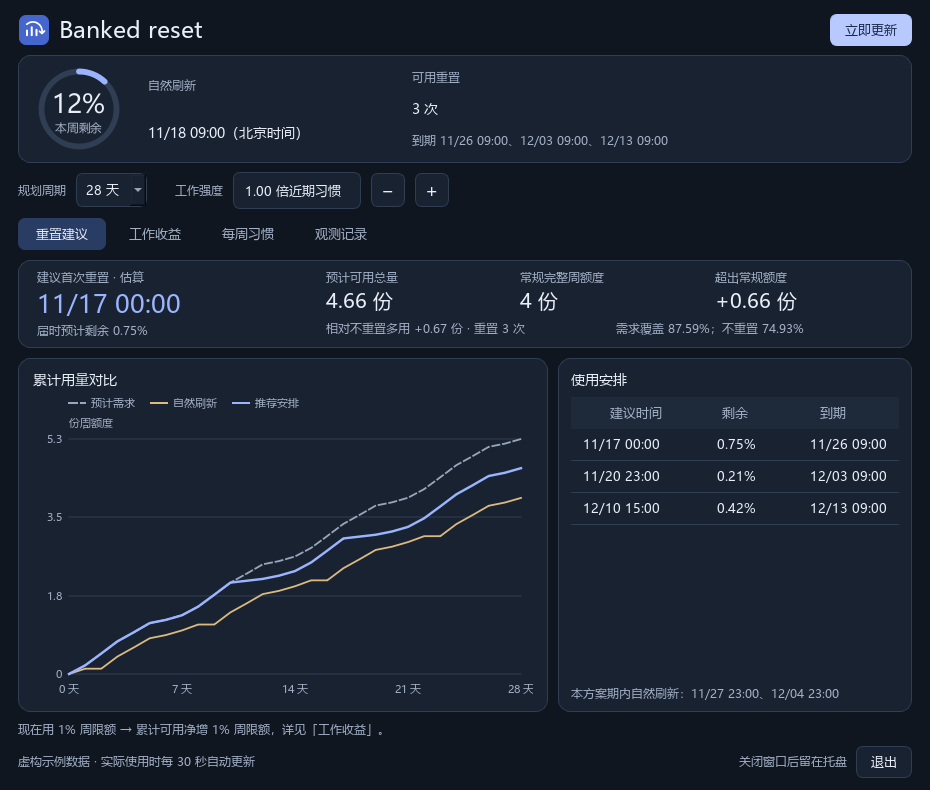
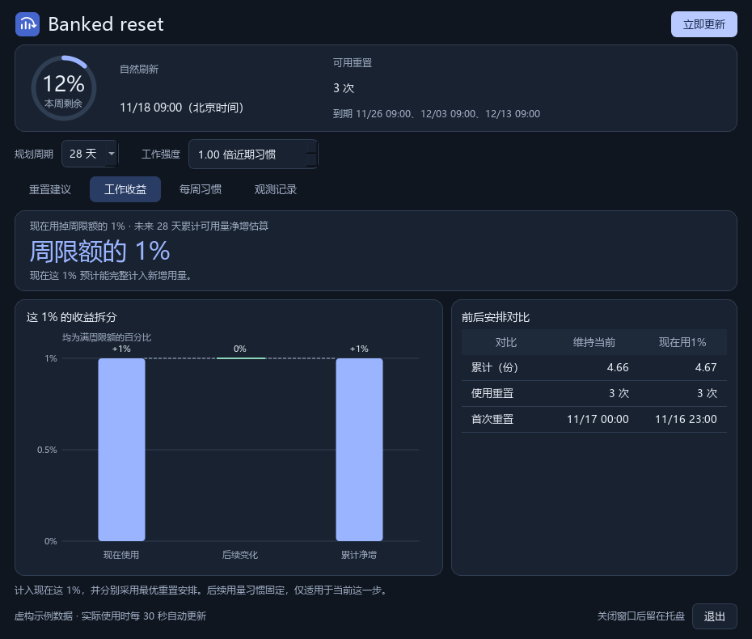

# Banked reset 计算器

一个原生 Windows 桌面工具，根据你自己的 Codex 用量习惯，估算什么时候使用 Banked reset 更合算。

**[下载 Windows x64 版](https://github.com/Isabelle20070607/bank-reset-calculator/releases/latest)** · [查看源码](https://github.com/Isabelle20070607/bank-reset-calculator)



## 下载使用

1. 准备 Windows 10 / 11 x64，以及已经登录的 [Codex CLI](https://learn.chatgpt.com/docs/codex/cli)。工具使用你自己的账户；不附带任何登录信息。
2. 在 Releases 下载 `BankedReset-版本号-windows-x64.zip`，完整解压到固定文件夹。
3. 双击 `BankedReset.exe`。下载包内已包含 Python、Qt 和 Node.js，无需另行安装这些运行时；不要只移动 exe，保留 `_internal` 文件夹。
4. 可选：运行同目录的 `install-shortcuts.ps1`，创建桌面和开始菜单入口，并设置 `Ctrl+Alt+B`。也可以使用 Windows 自带的“创建快捷方式”。

Codex CLI 可按官方说明安装并运行 `codex login` 登录。若工具找不到 CLI，可将环境变量 `BANK_RESET_CODEX_BIN` 设为原生 `codex.exe` 的完整路径；npm 安装目录里的原生文件也会自动查找。

关闭窗口后继续在托盘采集，重复打开会唤起同一个窗口。点击窗口或托盘菜单的“退出”才会停止。没有开机自启，也不会自动兑换 reset。

首次使用会扫描本地最近的 Codex 用量记录。历史不足时会显示缺少哪些时段；积累到足够记录后自动开始预测。

## 能做什么

- 每 30 秒读取剩余周额度、可用 reset 数量及到期时间，自动拟合并更新建议。
- 将周一至周日分别拟合，并细分到 3 小时时段，使用最近 28 天的历史。
- 比较 14 / 28 / 42 天内的可用额度，展示建议使用时间和累计用量曲线。
- 并列显示预计可用总量、常规完整周额度和差值：规划几周就以几份周额度为基准。
- 支持按近期习惯的 0.25–3 倍调整预计工作强度，可直接输入或用「− / +」按钮每次调整 0.05 倍。
- “工作收益”直接回答：现在消耗满周限额的 1%，规划期内累计可用量预计净增多少。
- 跟随系统明暗配色，包含额度圆环、七天日耗柱状图及观测记录。

## 计算约定

当前针对按周计量的 Codex 账户。存在额外短期窗口、reset 到期信息不完整或数据连接中断时，会显示原因并暂缓完整规划。

规划比较指定期间预计实际能使用的额度，计入使用 reset 对后续周刷新时间的影响。按小时搜索，并加入当前额度耗尽时点；reset 到期前预留 1 小时。同收益优先少用 reset，再优先减少丢弃的剩余额度。建议是这个候选时间集合和预测需求下的估算。

不会预设未来会赠送 reset 或发生额外全局重置。额外补额度或重置实际发生后，下次采集会按服务端返回的额度、刷新时间和 reset 数量重新规划。正常周刷新参与计算。

历史拟合排除额度耗尽后的时段，避免将受限状态当成低需求；跨记录的消耗按间隔均摊。同一窗口内已用比例下降超过 1 个百分点时，从新计数继续统计，并排除跨变更的未知时段；1 个百分点的回落沿用抖动处理，不凭这些变化认定发生了全局重置。

时间按北京时间显示。实际额度及刷新时间以账户返回信息为准。

### 相对常规周额度的总量

“预计可用总量”是按当前工作强度和最优重置安排，规划期内预计实际能用的累计额度。“常规完整周额度”固定为 **规划天数 ÷ 7**，因此 14 / 28 / 42 天分别为 2 / 4 / 6 份，不随工作强度、当前余额或刷新日期变化。

“超出常规额度”＝**预计可用总量 − 常规完整周额度**。例如 28 天预计用到 5.87 份，则显示常规 4 份、超出 +1.87 份；若预计用到 3 份，则显示 −1 份。这个基准按每周完整额度计，未用完的额度也包含在内。

下方“相对不重置多用”仍按同一使用习惯，比较使用重置与不使用重置时预计实际能用到的总量；累计曲线也采用这两种预测。它与减去完整周额度的差值分别展示。

## 每用 1% 的收益

“工作收益”固定当前选择的规划周期与后续用量习惯，比较当前状态和立即用掉 **满周限额的 1 个百分点** 后的最优安排。这里的 1% 始终以一周满额为基数。

累计净增的计算是：**现在使用的 1% ＋ 调整后的后续可用量 − 当前计划的后续可用量**。图中分开展示现在的 1%、后续变化及累计净增；表格对比累计用量、所需 reset 数量及首次重置时间。两种情形使用同一候选时间集合，后续用量习惯没有整体放大。

如果这一步只是将未来的用量提前，累计净增可能为 0；如果利用了本来会闲置的额度，或更早满足重置条件，结果也可能为 1% 或更高。数值随账户余额、到期时间及规划周期自动更新，仅适用于当前这一步，不能按固定比例外推。



## 数据与隐私

通过 Codex app-server 的只读账户接口获取额度，并增量读取当前用户的本地 Codex 用量日志。拟合与计算不调用模型，没有额外遥测或上传接口。

缓存只保存额度、时间、计划类型及日志文件的读取位置，不保存会话正文。登录由用户自己的 Codex CLI 处理，计算器不读取或分发登录 token。

发行版的缓存、偏好与日志保存在 `%LOCALAPPDATA%\BankedResetCalculator\`；源码运行保存在项目 `runtime/`。GitHub 源码和下载包不包含开发者的用量缓存、日志或个人快捷方式。仓库中的界面预览使用虚构数据。

## 从源码运行

需要 Python 3.10+、Node.js 和已登录的 Codex CLI。本次 Windows 发行包使用 Python 3.14、PySide6 6.11.0 构建。

```powershell
git clone https://github.com/Isabelle20070607/bank-reset-calculator.git
cd bank-reset-calculator
python -m venv .venv
.venv\Scripts\python.exe -m pip install -r requirements.txt
.venv\Scripts\python.exe desktop.py
```

`start.ps1`、`stop.ps1` 和 `install-shortcuts.ps1` 会优先使用项目 `.venv`，否则使用 PATH 中的 Python。`desktop.py --status` / `--quit` 通过当前用户的本地管道读取状态或退出实例。

原生界面使用普通窗口设置启动；后台采集通过关闭到托盘实现。不要使用 Windows 强制隐藏启动，这可能导致 Qt 的可见状态与实际窗口不一致。

## 验证与构建 Windows 包

```powershell
.venv\Scripts\python.exe -m unittest discover -s tests -v
node tests/check-core.cjs
.venv\Scripts\python.exe -m pip install -r requirements-build.txt
.\scripts\build-windows.ps1 -PythonExe .venv\Scripts\python.exe -Version 0.2.2
```

构建脚本将 Node.js、图标、计算代码及运行时许可证加入包中，执行不读取账户数据的发行包自检，然后生成 `dist/BankedReset-0.2.2-windows-x64.zip`。须在 Windows x64 的独立 CPython 环境中构建；默认使用 PATH 中的 Node.js，也可用 `-NodeExe` 指定。

测试覆盖增量采集、七天独立拟合、额度耗尽及补充、连接失败、北京时间跨日、周刷新时间变化、到期边界、小规模穷举比较、1% 的净增拆分及过期结果清除。

源码中的 `tracker.py` 负责采集，`usage_store.py` 负责拟合，`calculator.js` 是唯一的规划算法；原生 Qt 界面通过后台 Node 进程运行算法，没有嵌入浏览器或 HTTP 服务。

第三方许可见 [THIRD_PARTY_NOTICES.md](THIRD_PARTY_NOTICES.md)。本项目是独立工具，与 OpenAI 无隶属关系。
